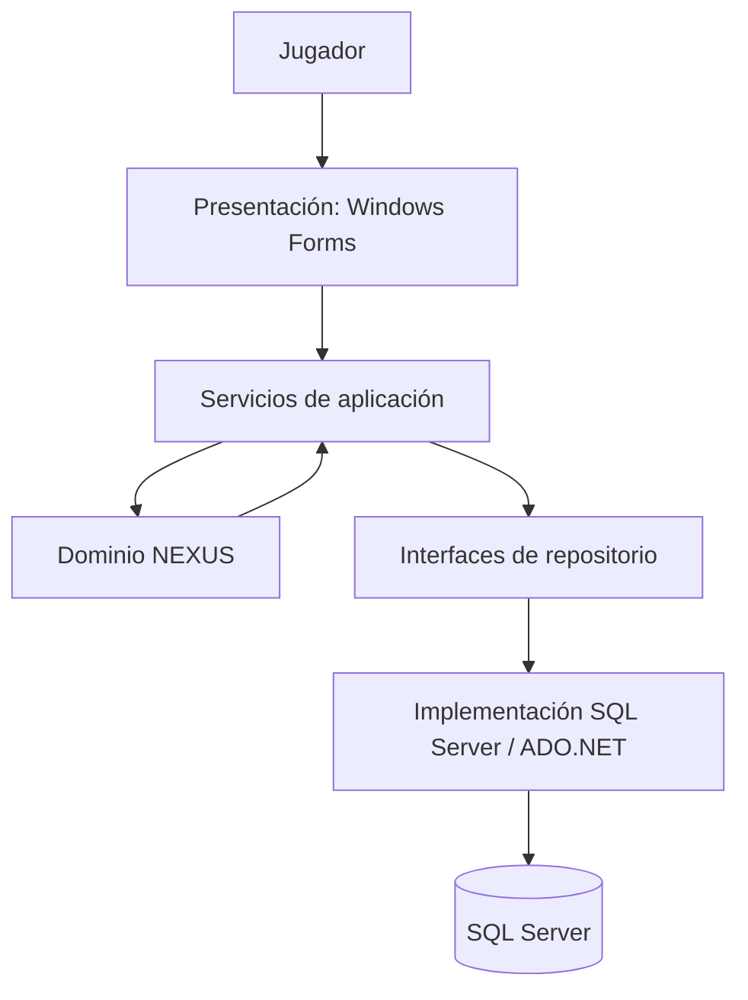
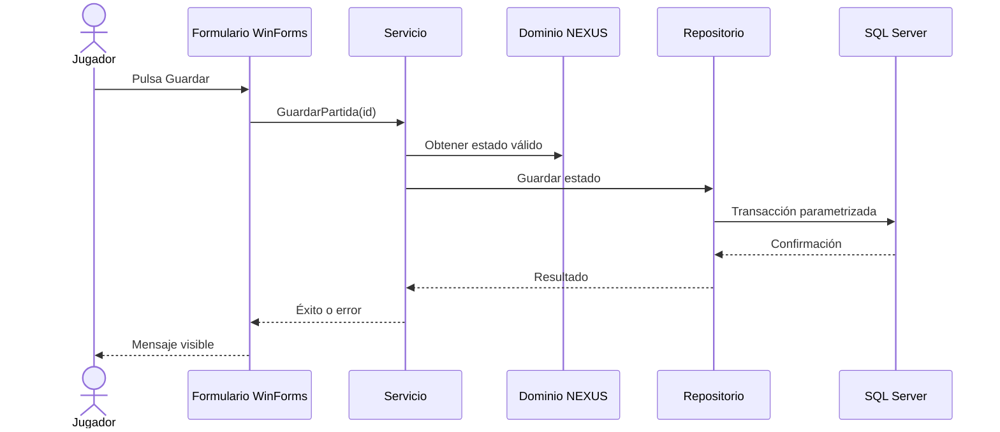

# Arquitectura propuesta para NEXUS

## 1. Objetivo
Evolucionar el proyecto de consola H3 hacia una aplicación de escritorio C# con Windows Forms y SQL Server, manteniendo las reglas en el dominio. La migración será incremental: separar responsabilidades, crear servicios, agregar persistencia y construir formularios.

## 2. Capas
1. **Presentación (Windows Forms):** formularios de menú, mapa, misiones e inventario. Muestran el estado y capturan eventos; no calculan daño, costos ni recompensas.
2. **Aplicación / servicios:** coordina iniciar/cargar partida, moverse, explorar, actuar en encuentros, usar objetos, completar misiones y guardar.
3. **Dominio:** clases actuales Personaje, Cadete, Robot, Enemigo, Inventario, Mision, MundoNexus y Simulacion. Se extraerán gradualmente a archivos propios y no dependerán de controles ni SQL.
4. **Infraestructura / datos:** repositorios y mapeo usando Microsoft.Data.SqlClient y SQL Server.

## 3. Diagrama de arquitectura

Los servicios dependen de contratos como IPartidaRepository. La implementación SQL vive en infraestructura, de modo que las reglas pueden probarse sin formularios ni una base real.

## 4. Componentes propuestos

| Componente | Responsabilidad | Relación con H3 |
|---|---|---|
| MenuForm | Nueva partida, continuar, exploradores, opciones y salir | Sustituye el menú textual de Program.cs / NexusV2. |
| ExploracionForm | Mapa, estadísticas y acciones | Presenta Mapa(), Mover() y Explorar() de MundoNexus. |
| MisionesForm | Objetivos y estado | Presenta Mision.Estado() y delega validación al dominio. |
| InventarioForm | Objetos, cantidades y acciones | Presenta Inventario, UsarObjeto() y EliminarObjeto(). |
| JuegoService | Coordina acciones y actualiza estado | Extrae el bucle actual de NexusV2. |
| SimulacionService | Coordina entrenamiento, IRIS y seguridad | Encapsula el flujo que hoy coordina Program.EjecutarSesion(). |
| IPartidaRepository | Contrato de guardar/cargar | Nueva abstracción, no existe en H3. |
| SqlPartidaRepository | Lectura/escritura con parámetros y transacciones | Nueva infraestructura. |

## 5. Secuencia de guardado

## 6. Decisiones
- Mantener .NET 8 al inicio para minimizar cambios respecto a NexusTraining.csproj; comprobar SDK y soporte instalados antes de migrar.
- Cambiar a WinExe y activar UseWindowsForms=true cuando exista un formulario de inicio, no antes.
- Usar Microsoft.Data.SqlClient con consultas parametrizadas; no concatenar texto del jugador en SQL.
- Abrir conexiones por operación y disponerlas con using; usar transacciones si se actualizan varias tablas.
- Guardar tras acciones importantes y ofrecer guardado manual.
- Conservar Pruebas.cs como regresión; más adelante separar las pruebas en un proyecto dedicado.
- Configurar la conexión fuera del código y versionar solo una plantilla sin secretos.

## 7. Plan incremental
1. Registrar pruebas de regresión de las reglas actuales.
2. Extraer las clases de NexusV2.cs a archivos separados sin cambiar reglas.
3. Crear servicios de aplicación que envuelvan Simulacion y MundoNexus.
4. Crear formularios y conectar eventos con los servicios.
5. Implementar esquema SQL, repositorio y pruebas de guardar/cargar.
6. Probar nueva partida, movimiento, encuentro, recompensa, guardado, cierre y continuación.
