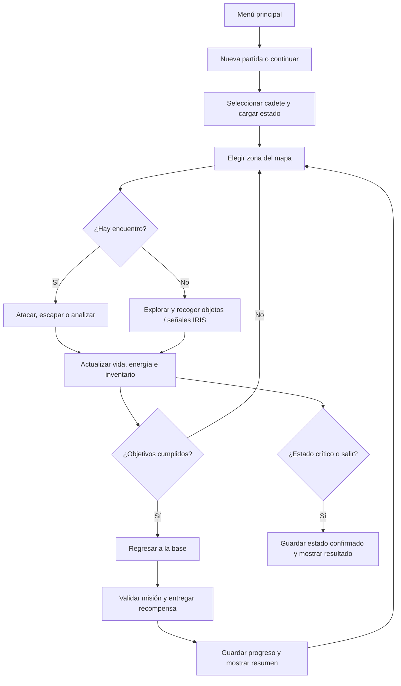

# NEXUS V1.0 — Diseño del videojuego

> Diseño de la evolución del proyecto H3. Las pantallas descritas son bocetos, no una interfaz ya implementada.

## 1. Visión del juego
NEXUS es una aventura de exploración de ciencia ficción ambientada en 2297. El jugador controla a un cadete explorador que recorre realidades inestables, administra energía y estabilidad, investiga señales de IRIS, resuelve encuentros y regresa con vida. Lo motivan los fragmentos narrativos, completar misiones, conseguir objetos y ganar experiencia.

El repositorio H3 ya contiene dos recorridos de consola: entrenamiento de ecos temporales mediante la clase **Simulacion** y la misión **La anomalía perdida** mediante **MundoNexus**, accesible con el argumento **--v2**. La versión gráfica conservará estas reglas y las presentará de forma coherente.

## 2. Ciclo principal de juego

Cada acción informa su costo, daño, hallazgo o resultado. Al cerrar y volver a abrir la aplicación, el jugador debe poder recuperar la última partida guardada.

## 3. Mecánicas y reglas
### Explorador, energía y estabilidad
- La clase Cadete empieza con 100 de vida y 70 de energía; la energía se limita a 100 al recuperar.
- La clase Simulacion solicita nombre, edad, realidad, energía y estabilidad. Autoriza la inmersión con edad >= 16, energía >= 40 y estabilidad >= 60.
- En Simulacion, cartografiar cuesta 12 de energía y 8 de estabilidad; desde la segunda exploración consecutiva cuesta 19 y 14. Decodificar consume 18 de energía y 12 de estabilidad. Una celda recupera hasta 22 de energía y resta 4 de estabilidad. Recalibrar cuesta 10 de energía y recupera hasta 18 de estabilidad.
- IRIS alerta cuando estabilidad <= 30 o cuando energía <= 20 y estabilidad <= 45. El corte ocurre con estabilidad <= 10, o energía = 0 y estabilidad <= 25.
- En MundoNexus, mover a una zona vecina cuesta 5 de energía, explorar cuesta 6 y atacar cuesta 8. Se conservan los valores de daño, escudo y objetos programados en H3.

### Mapas
La misión actual usa cuatro zonas conectadas en secuencia: **Base de extracción**, **Bosque de ecos**, **Ruinas orbitales** y **Zona de anomalía**. Solo se permite moverse a una zona vecina; durante un encuentro hay que resolverlo antes de moverse. Los mapas existentes, incluida la realidad LUMEN-07 del entrenamiento, son la base del diseño. No se inventan mapas nuevos en el MVP.

### Misiones
La misión **La anomalía perdida** exige alcanzar la zona de anomalía, recuperar el núcleo, superar el encuentro hostil y regresar a la base con vida. La recompensa actual es 100 XP y un módulo desconocido. La interfaz mostrará objetivos, pero el dominio validará su cumplimiento.

### Inventario y encuentros
Los objetos existentes son Celula, Escudo, ModuloAtaque, Analizador, Nucleo y ModuloDesconocido. Se muestran cantidades y acciones válidas. El núcleo no se puede eliminar. Ante una entidad, las acciones son atacar, escapar o analizar; atacar gasta energía y puede provocar una respuesta, escapar causa daño y deja el objetivo pendiente, y analizar requiere un analizador.

## 4. Diseño de pantallas y navegación
Los wireframes legibles están en [evidencias/bocetos-y-diagramas.md](evidencias/bocetos-y-diagramas.md):
1. **Menú principal:** Nueva partida, Continuar, Exploradores, Opciones y Salir.
2. **Exploración / mapa:** zonas, ubicación actual, vida, energía, estabilidad y acciones.
3. **Misiones:** objetivos pendientes/completados, estado y recompensas.
4. **Exploradores / inventario:** estadísticas, objetos, cantidades y acciones permitidas.

Navegación: Menú → Nueva partida → ficha del cadete → mapa. Continuar carga la última partida. Desde el mapa se accede a Misiones e Inventario. Al terminar, se muestra un resumen y se guarda antes de volver al mapa o menú. Salir confirma si hay cambios sin guardar.

## 5. Experiencia de usuario
- Tipografía legible (10–12 pt mínimo para controles normales), contraste alto y títulos claros.
- Jerarquía: vida/energía/estabilidad, objetivo activo, mapa y luego acciones secundarias.
- Navegación y ubicación de botones consistentes.
- Mensajes claros de éxito/error y valores numéricos además de barras o colores.
- Deshabilitar acciones sin energía; confirmar antes de abandonar partida; impedir eliminar objetos protegidos.
- Navegación por teclado, foco visible, controles con etiquetas descriptivas y formularios validados.
- Mostrar cuándo se guardó el progreso y explicar errores de conexión sin perder el último estado confirmado.

## 6. Alcance y restricciones
**Prioridad MVP:** Windows Forms; perfil de cadete; mapa de cuatro zonas; exploración y encuentros; panel de estado; misiones e inventario; guardar/cargar con SQL Server; validaciones y pruebas de reglas.

**Opcional después:** historial de IRIS, resumen detallado, selección de varias partidas, reportes de progreso, animaciones y sonido.

**Fuera de alcance inicial:** multijugador en línea, mundo abierto, generación procedural compleja, cinemáticas, tienda y motor 3D.

Restricciones: conservar el código H3 como base; WinForms y SQL Server son evolución propuesta, no funcionalidades actuales. Las reglas se ejecutan en el dominio, no en los botones. No incluir credenciales en GitHub. Mantener un desarrollo por etapas y conservar el modo de consola para pruebas de regresión.
