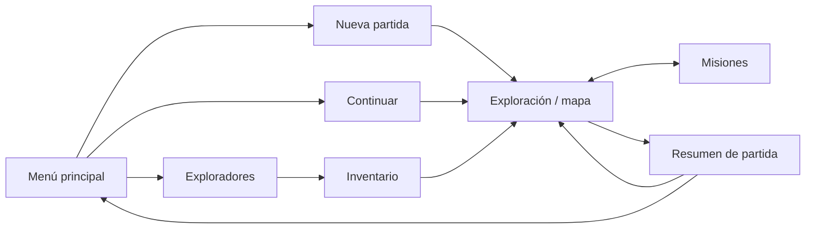

# Evidencias de diseño — NEXUS V1.0

Estos wireframes son bocetos legibles de escritorio, no capturas de una aplicación funcional. Los controles se ajustarán después en el diseñador de Windows Forms.

## 1. Menú principal
```text
┌──────────────────────────────────────────────────────────────────┐
│ NEXUS V1.0                                  AÑO 2297              │
│ ACADEMIA DE EXPLORADORES                                         │
│                                                                  │
│          [ Fondo: horizonte de una realidad inestable ]          │
│                                                                  │
│                 ┌────────────────────────┐                       │
│                 │      NUEVA PARTIDA     │                       │
│                 ├────────────────────────┤                       │
│                 │      CONTINUAR         │                       │
│                 ├────────────────────────┤                       │
│                 │      EXPLORADORES      │                       │
│                 ├────────────────────────┤                       │
│                 │      OPCIONES          │                       │
│                 ├────────────────────────┤                       │
│                 │      SALIR             │                       │
│                 └────────────────────────┘                       │
│ Estado: listo para iniciar                                        │
└──────────────────────────────────────────────────────────────────┘
```
Navegación: Nueva partida abre el registro del cadete; Continuar carga una partida válida; Exploradores abre perfil/inventario; Opciones ajusta preferencias; Salir confirma si hay cambios sin guardar.

## 2. Exploración / mapa
```text
┌──────────────────────────────────────────────────────────────────┐
│ NEXUS > EXPLORACIÓN       MISIÓN: LA ANOMALÍA PERDIDA             │
├───────────────────────────────────────┬──────────────────────────┤
│ MAPA DE ZONAS                         │ ESTADO DEL CADETE         │
│                                       │ Nombre: Cadete            │
│ [Base]—[Bosque de ecos]—[Ruinas]      │ Vida       100/100        │
│                              |        │ Energía     70/100        │
│                        [Anomalía]     │ Estabilidad 80/100*       │
│                                       │ Escudo          0         │
│ Zona actual: Base de extracción       ├──────────────────────────┤
│ IRIS: señal débil detectada           │ [Explorar] [Mover]        │
│                                       │ [Analizar] [Volver]       │
├───────────────────────────────────────┴──────────────────────────┤
│ Registro: movimiento / coste / hallazgo / alerta                  │
└──────────────────────────────────────────────────────────────────┘
```
Navegación: elegir una zona vecina y confirmar. Durante un encuentro solo se muestran acciones válidas. La estabilidad se usa en el modo entrenamiento; no sustituye a la energía en el modo misión.

## 3. Misiones
```text
┌──────────────────────────────────────────────────────────────────┐
│ NEXUS > MISIONES                                                  │
├──────────────────────────────────────────────────────────────────┤
│ LA ANOMALÍA PERDIDA                    ESTADO: EN CURSO            │
│                                                                  │
│ [✓] Alcanzar la zona de anomalía                                 │
│ [✓] Recuperar el núcleo energético                               │
│ [ ] Superar el encuentro con la entidad hostil                   │
│ [ ] Regresar a la base con vida                                  │
│                                                                  │
│ Recompensa: 100 XP + módulo desconocido                           │
│                                                                  │
│ [Ver mapa]         [Continuar misión]                [Volver]     │
└──────────────────────────────────────────────────────────────────┘
```
Los estados del dibujo son ilustrativos: la implementación debe leer los valores reales de Mision, no dejar objetivos marcados de forma fija.

## 4. Exploradores e inventario
```text
┌──────────────────────────────────────────────────────────────────┐
│ NEXUS > EXPLORADOR E INVENTARIO                                   │
├────────────────────────────────┬─────────────────────────────────┤
│ PERFIL DEL CADETE               │ INVENTARIO                      │
│ Nombre: Cadete                  │ [Célula de energía] x2          │
│ Vida: 100/100                   │ [Escudo]             x1         │
│ Energía: 70/100                 │ [Módulo de ataque]    x1         │
│ Experiencia: 0 XP               │ [Analizador]          x1         │
│ Escudo: 0                       │ [Núcleo]              x1         │
│ Ataque extra: 0                 │                                 │
│                                 │ Selección: Célula de energía    │
│                                 │ [Usar objeto] [Eliminar]        │
├────────────────────────────────┴─────────────────────────────────┤
│ [Volver al mapa]               Mensaje: objeto usado / error       │
└──────────────────────────────────────────────────────────────────┘
```
Las cantidades son ejemplos visuales, no valores fijos del formulario. En ejecución deben proceder del inventario actual.

## 5. Navegación entre pantallas


## 6. Criterios visuales
- Fondo azul oscuro, paneles contrastados y acentos cian; ámbar reservado para advertencias.
- Indicadores de estado en una zona fija, con texto y número además de color.
- Mensajes cerca del control que los produce.
- Botones claros, foco visible y navegación por teclado.
