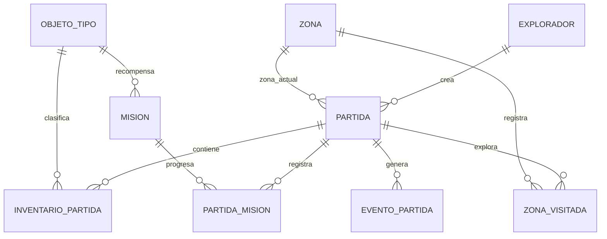

# Modelo de datos propuesto — NEXUS

## 1. Propósito y estado
El modelo guardará y recuperará partidas sin delegar las reglas del juego a la base de datos. **Es un diseño propuesto; el repositorio H3 todavía no tiene tablas ni conexión SQL Server.**

## 2. Entidades y campos principales

| Tabla | Campos principales | Propósito |
|---|---|---|
| Explorador | ExploradorId PK, Nombre, FechaCreacion | Perfil del cadete. |
| Partida | PartidaId PK, ExploradorId FK, NombrePartida, FechaCreacion, FechaActualizacion, EstadoPartida, ModoJuego, ZonaActualId FK nullable, Vida, Energia, Estabilidad nullable, Experiencia, Escudo, AtaqueExtra, Conectada, VersionModelo | Estado recuperable de una sesión. |
| Zona | ZonaId PK, Codigo UNIQUE, Nombre, Orden, ZonaAnteriorId FK nullable | Catálogo de zonas conectadas. |
| Mision | MisionId PK, Codigo UNIQUE, Nombre, Descripcion, RecompensaXP, RecompensaObjetoTipoId FK nullable | Definición de misión y recompensa. |
| PartidaMision | PartidaId PK/FK, MisionId PK/FK, ZonaAlcanzada, NucleoEncontrado, EncuentroSuperado, Completada, FechaCompletada nullable | Progreso de misión por partida. |
| ObjetoTipo | ObjetoTipoId PK, Codigo UNIQUE, Nombre, EsConsumible, EsProtegido | Catálogo equivalente a TipoObjeto. |
| InventarioPartida | PartidaId PK/FK, ObjetoTipoId PK/FK, Cantidad CHECK >= 0 | Cantidades de objetos. |
| ZonaVisitada | PartidaId PK/FK, ZonaId PK/FK, FechaPrimeraVisita | Evita duplicar hallazgos de primera visita. |
| EventoPartida | EventoId PK, PartidaId FK, FechaEvento, TipoEvento, Mensaje, EnergiaResultante nullable, EstabilidadResultante nullable | Historial de IRIS y resumen de sesión. |

Tipos recomendados: INT IDENTITY para claves; NVARCHAR para texto; DATETIME2 para fechas; BIT para indicadores. Aplicar claves foráneas, índices por partida/explorador y restricciones de rango. La columna ModoJuego distingue el entrenamiento de Simulacion y la misión de MundoNexus.

## 3. Relaciones

## 4. Correspondencia con H3

| Propiedad/clase existente | Persistencia propuesta |
|---|---|
| Simulacion.Nombre, Edad, Realidad | Explorador y metadatos de Partida; guardar Edad solo si se justifica en el perfil. |
| Simulacion.Energia, Estabilidad, Ecos, FragmentosIris, Celdas, Alertas, Conectada, Motivo | Partida y EventoPartida. Añadir columnas Ecos, FragmentosIris, Celdas y Alertas si se guarda el entrenamiento completo. |
| MundoNexus.Zona y zonas visitadas | Partida.ZonaActualId y ZonaVisitada. |
| Cadete.Vida, Energia, Experiencia, Escudo, AtaqueExtra | Partida. |
| Inventario y TipoObjeto | ObjetoTipo e InventarioPartida. |
| Mision.ZonaAlcanzada, NucleoEncontrado, EncuentroSuperado, Completada | PartidaMision. |
| Mensajes de IRIS | EventoPartida. |

Antes de guardar a mitad de un combate se necesitará una tabla EncuentroPartida con tipo de entidad, vida restante, zona y estado.

## 5. Guardado y recuperación
1. Crear/seleccionar Explorador y crear Partida con valores iniciales validados por el dominio.
2. Después de una acción aceptada, guardar partida, inventario, progreso de misión, zonas visitadas y evento dentro de una transacción.
3. Si falla una escritura, revertir y mostrar un mensaje claro; el último estado confirmado debe seguir disponible.
4. Para continuar, cargar la partida no finalizada más reciente y reconstruir el dominio con inventario, misión y zonas visitadas.
5. Al completar/fallar, guardar estado final y resumen sin sobrescribir partidas anteriores.
6. Usar consultas parametrizadas, permisos mínimos y cadena de conexión externa al repositorio.

## 6. Alcance inicial
Primero implementar Explorador, Partida, Zona, Mision, PartidaMision, ObjetoTipo e InventarioPartida. Agregar ZonaVisitada y EventoPartida si la recuperación necesita historial. Versionar los cambios de esquema con migraciones o scripts SQL revisados.
